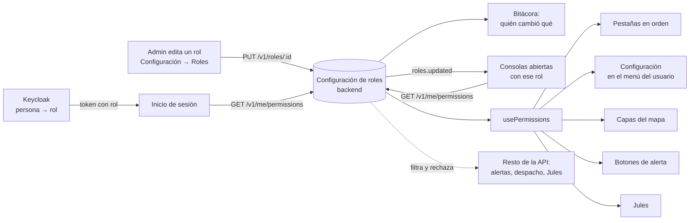

# Roles y permisos: arquitectura

Fecha: 27/11/2026 · Proto Panopticon 33 (`app/`) · Estado: **decisiones cerradas, listo para revisar con desarrollo**

## Intención

Hoy lo que ve y hace cada rol está repartido en el código: una parte se configura (capas del mapa, alcance de alertas) y otra está escrita a mano (`role === 'operator_911'` en ~25 lugares). La idea es que **todo lo que define a un rol se configure en un solo lugar**, Configuración → Roles, y que la consola lo lea de ahí.

Un rol define seis cosas:

1. **Capas del mapa**: cuáles ve y cuáles están prendidas al entrar. *(ya existe)*
2. **Pestañas**: cuáles ve (Estado, Alertas, Investigaciones, Personas) y **en qué orden**. La primera es la que se abre al entrar.
3. **Alcance de alertas**: todas o solo las de su territorio, y desde qué criticidad. *(ya existe)*
4. **Gestión de alertas**: qué puede hacer sobre una alerta, por niveles.
5. **Jules**: lo tiene o no.
6. **Acceso a Configuración**: si puede entrar a Configuración (hoy, Administración), desde el menú del usuario.

Cada usuario hereda la configuración de su rol, limitada a su territorio. **No hay excepciones por usuario**: si alguien necesita algo distinto, se crea otro rol.

## Decisiones (27/11)

| # | Tema | Decisión |
| --- | --- | --- |
| 1 | Roles nuevos | El admin puede crear roles, además de editar los 4 de base |
| 2 | Gestión de alertas | Por niveles: Solo ver / Decidir / Decidir y despachar / Personalizado |
| 3 | Excepciones por usuario | No. Todo se define en el rol |
| 4 | Jules | Solo sí o no. Dónde aparece es igual para todos |
| 5 | Cuándo aplica un cambio | Al instante, sin volver a entrar |
| 6 | Configuración | No es una pestaña: es un acceso aparte, en el menú del usuario. Si el rol solo tiene Configuración, la consola se abre directo ahí |

## Cómo está hoy

| Qué | Dónde | Configurable |
| --- | --- | --- |
| Capas por rol (`oculta` / `disponible` / `inicio`) | `RoleConfig.layers` en `api/seed.ts` | Sí, Configuración → Roles |
| Alcance y criticidad mínima | `RoleConfig.alertScope`, `minSeverity` | Sí (criticidad) |
| Pestañas por rol y su orden | `TOOLS` en `console/ctx.tsx` | No |
| Pestaña inicial | `DEFAULT_PANEL` en `console/ctx.tsx` | No |
| Fichas que puede abrir | `canOpenSheet` en `console/ctx.tsx` | No |
| Configuración | pestaña de Admin en `TOOLS` + `role === 'admin'` en `Console.tsx`, `ZoneSheet.tsx`, `EventSheet.tsx`, `CameraSheet.tsx` | No |
| Confirmar / descartar alertas | `role === 'operator_911'` en `AlertSheet.tsx`, `FacialSheet.tsx`, `FacialDossier.tsx` | No |
| Registrar incidente, mandar unidades | `role === 'operator_911' \|\| 'command'` en `Console.tsx`, `WhoArrives.tsx` | No |
| Jules en el lateral | `role === 'command'` en `Console.tsx`, `JulesSheet.tsx` | No |
| Lista de roles | `type Role` (4 valores fijos) en `api/types.ts` | No |
| Qué rol tiene cada persona | Keycloak | Fuera de la consola |

## Modelo de datos

```ts
/** Pestañas de la columna izquierda. Configuración ya no es una pestaña. */
type TabId = 'estado' | 'alertas' | 'investigar' | 'verificacion';

/** Qué puede hacer un rol sobre una alerta. Se guarda como lista para poder sumar acciones
    sin cambiar el modelo; la pantalla las agrupa en niveles (ver "Gestión de alertas"). */
type AlertAction =
  | 'decidir'          // confirmar o descartar (con motivo)
  | 'despachar'        // asignar unidades a una alerta confirmada
  | 'registrar'        // crear un incidente a mano desde el mapa
  | 'decidir_facial';  // confirmar o descartar una coincidencia facial

interface RoleConfig {
  id: string;                 // 'command', 'operator_911', 'analyst', 'admin' o uno creado ('supervisor_911')
  name: string;               // "Operador 911"
  description: string;        // "Decide las alertas"
  system: boolean;            // los 4 de base: se editan, no se borran

  layers: Record<LayerKey, LayerAccess>;          // ya existe

  /** Pestañas visibles, en orden. La primera se abre al entrar. Puede estar vacía solo si config es true. */
  tabs: TabId[];

  alerts: {
    scope: 'todas' | 'territorio';                 // ya existe (alertScope)
    minSeverity: Severity | null;                  // ya existe
    actions: AlertAction[];                        // vacío = solo lectura
  };

  jules: boolean;

  /** Entra a Configuración (zonas, cámaras, eventos, reglas, listas, roles, usuarios). */
  config: boolean;

  version: number;                                 // sube con cada cambio: avisa a las consolas abiertas
  updatedAt: number; updatedBy: string;
}
```

Configuración de partida (reproduce lo que hace hoy el código, para que nada cambie al migrar):

| | Mando | Operador 911 | Analista | Admin |
| --- | --- | --- | --- | --- |
| Pestañas (en orden) | Estado, Alertas | Alertas, Personas, Estado | Investigaciones, Estado | — |
| Configuración | No | No | No | Sí (se abre directo) |
| Gestión de alertas | Personalizado: despachar, registrar | Decidir y despachar | Solo ver | Solo ver |
| Jules | Sí | Sí | Sí | Sí |
| Capas, alcance | como hoy en `seed.ts` | | | |

Admin hoy también tiene la pestaña Estado. Con el modelo nuevo se le saca, para que entre directo a Configuración. Si se quiere que la siga viendo, se le suma la pestaña y entra a Estado; Configuración le queda en el menú.

## Reglas de cada parte

### Pestañas

- Lista ordenada. El orden se arma arrastrando; la primera es la pestaña de inicio (reemplaza `DEFAULT_PANEL`).
- Puede quedar vacía solo si el rol tiene Configuración. Sin pestañas ni Configuración el rol no se puede guardar.
- Bitácora queda fuera de la lista mientras no haya rol Auditor (hoy está retirada).

### Configuración

- **No es una pestaña.** Es un acceso: `config: true` suma la opción **Configuración** en el menú del usuario (el desplegable de arriba a la derecha, con nombre y rol), arriba de "Cerrar sesión". Sin acceso, la opción no aparece.
- **Al entrar:**
  - rol con pestañas y Configuración → abre la primera pestaña; a Configuración se llega desde el menú
  - rol solo con Configuración → abre directo Configuración, sin barra de pestañas
- **Dentro de Configuración**, si el rol también tiene pestañas, hay un botón "Volver a la consola" que lleva a la primera pestaña.
- Darle Configuración a un rol es hacerlo administrador. El editor lo marca con un aviso.
- Sin Configuración, zonas, cámaras y eventos se abren en solo lectura (sin "Editar", sin "Volver a este preset").

### Capas del mapa

Sin cambios: `oculta` / `disponible` / `inicio`. Se mueve del cuadro comparativo al editor de cada rol.

### Gestión de alertas

En pantalla se elige un **nivel**; por debajo se guarda la lista de acciones:

| Nivel | Acciones | Quién, de partida |
| --- | --- | --- |
| Solo ver | — | Analista, Admin |
| Decidir | `decidir`, `decidir_facial` | — |
| Decidir y despachar | `decidir`, `decidir_facial`, `despachar`, `registrar` | Operador 911 |
| Personalizado | lo que se marque | Mando (despacha y registra, no decide) |

Sin la acción, el botón **no aparece** (no se muestra deshabilitado), y la ficha muestra el aviso que ya existe: "Solo lectura: confirma o descarta el operador 911".

### Jules

- **Sí o no.** Con `jules: false` no aparece Jules en ningún lado: ni el lateral, ni la ficha, ni los botones que lo abren, ni el agente que corre de fondo en `JulesSheet`.
- **Aparece igual para todos los roles que lo tienen**: en el lateral derecho cuando no hay otra ficha abierta, y se puede minimizar a la franja de 64 px (como hoy lo ve Mando). Esto cambia lo que ven hoy Operador 911 y Analista, que lo abren como ficha.
- **Jules responde dentro de los permisos del rol**: no nombra alertas fuera de su alcance, no habla de capas ocultas (p. ej. ubicación de unidades) y no ofrece botones a pestañas o acciones que el rol no tiene. Hoy `console/jules.ts` ya cambia la respuesta según el rol a mano; pasa a leer la configuración.

### Roles nuevos

- `type Role` deja de ser una lista fija de 4: pasa a ser el `id` (texto) de un `RoleConfig`. `ROLE_LABEL` se reemplaza por `name`.
- **Se crea copiando uno existente** ("Duplicar Operador 911") o desde cero. Desde cero arranca en lo mínimo: solo la pestaña Estado, capas en Disponible, solo ver alertas, sin Jules, sin Configuración.
- **Nombre único**. El `id` se arma del nombre al crearlo y no cambia aunque se renombre (el rol de Keycloak apunta a ese id).
- **Keycloak**: para que alguien tenga el rol nuevo, tiene que existir el mismo rol en Keycloak. En la primera versión el editor muestra el id a copiar ("Creá en Keycloak el rol `supervisor_911`"). Más adelante, la plataforma lo crea sola por la API de Keycloak.
- Si una persona entra con un rol de Keycloak que no existe en la plataforma: no entra, y ve "Tu rol no tiene acceso configurado. Pedíselo al administrador." Nunca se le da un rol por defecto.
- **Borrar**: solo si ningún usuario lo tiene y no es uno de los 4 de base.
- Crear, renombrar y borrar quedan en la bitácora.

### Fichas (lado derecho)

No se configuran aparte: salen de lo anterior, para que el admin no tenga que pensar en ellas.

| Ficha | Se abre si… |
| --- | --- |
| Alerta | ve la capa Alertas o la pestaña Alertas |
| Facial | tiene la pestaña Personas, la acción `decidir_facial` o ve alertas (en solo lectura) |
| Vehículo, Historia | tiene la pestaña Investigaciones |
| Configuración, formulario de evento | tiene Configuración |
| Zona, cámara, evento | siempre (en solo lectura sin Configuración) |
| Jules | `jules` |

### Validaciones al guardar

Errores (no deja guardar):
- rol sin pestañas y sin Configuración
- sacarle Configuración al último rol que la tiene (nadie podría volver a configurar)
- sacarle Configuración al rol propio

Avisos (deja guardar):
- puede decidir alertas pero no tiene la pestaña Alertas ni la capa Alertas: no va a poder llegar a ellas
- puede despachar pero la capa Unidades está oculta
- tiene `decidir_facial` pero no la pestaña Personas
- tiene Configuración: es administrador

## Cambios al instante

Un cambio en un rol se aplica **en todas las consolas abiertas con ese rol, sin volver a entrar**.

1. El admin guarda. El backend sube `version` y emite `roles.updated { roleId, version }` por el canal en vivo que ya usa la consola para alertas.
2. Cada consola con ese rol vuelve a pedir `GET /v1/me/permissions` y lo aplica:

| Qué cambió | Qué pasa en la pantalla |
| --- | --- |
| Orden de pestañas | La barra se reordena; la persona se queda en la pestaña que estaba |
| Se quitó la pestaña abierta | Pasa a la primera pestaña |
| Se quitó una capa (`oculta`) | Se apaga y desaparece de la franja de capas |
| Una capa pasó a "Al entrar" | No se prende sola: aplica la próxima vez que entra (no le cambiamos el mapa a mitad de trabajo) |
| Se quitó una acción | El botón desaparece de la ficha abierta |
| Se quitó Jules | Jules se cierra y deja de correr de fondo |
| Se quitó Configuración estando adentro | Sale a la primera pestaña |
| La ficha abierta ya no se puede abrir | Se cierra |

3. Si algo cambió de lo que la persona tiene a la vista, ve un aviso corto: "Tu rol cambió: ya no ves Unidades policiales". Si solo se sumaron permisos, el aviso es "Tu rol cambió: ahora podés despachar unidades".
4. Si una acción sale justo cuando se quitó el permiso, la API la rechaza (403) y la ficha lo dice: "Ya no tenés permiso para esto. Tu rol cambió."

Cambiar **qué rol tiene una persona** se hace en Keycloak y aplica cuando se renueva su sesión (lo define la duración del token en Keycloak), no al instante.

En la demo (`app/`), `roleConfigs` ya vive en el estado compartido (`useApi`), así que un cambio se ve sin recargar; falta lo de la pestaña quitada, las fichas y el aviso.

## Cómo lo usa la consola

Un solo módulo nuevo, `console/permissions.ts`, reemplaza `TOOLS`, `DEFAULT_PANEL`, `DEFAULT_SHEET`, `canOpenSheet`, `canOpenPanel` y los `role ===` sueltos:

```ts
const p = usePermissions();     // lee el RoleConfig del usuario en sesión (y se actualiza solo)
p.tabs                           // TabId[] en orden, para la barra de pestañas
p.home                           // p.tabs[0], o Configuración si no hay pestañas
p.config                         // muestra "Configuración" en el menú del usuario
p.layer('units')                 // 'oculta' | 'disponible' | 'inicio'
p.can('decidir')                 // acciones sobre alertas
p.canOpen(sheet)                 // fichas, según la tabla de arriba
p.jules                          // boolean
```

Ningún componente vuelve a preguntar por el nombre del rol. Si mañana se crea "Supervisor 911", la consola no se toca.

El selector de roles de la demo (en el mismo menú del usuario) queda solo para la demostración; en producción el rol llega del token.

## Flujo



- **Keycloak** dice quién es la persona y qué rol tiene. **La plataforma** guarda qué significa cada rol. No se duplican permisos en Keycloak.
- **El front oculta; el backend hace cumplir.** Esconder un botón no es seguridad: la API filtra las alertas por alcance y rechaza (403) una acción que el rol no tiene, también las de Jules y las de Configuración.
- Cada cambio queda en la bitácora (ya existe `audit` en `updateRoleConfig`), con el detalle de qué campo cambió.

## API

| Método | Ruta | Qué hace |
| --- | --- | --- |
| GET | `/v1/me/permissions` | El `RoleConfig` del usuario en sesión, más su territorio |
| GET | `/v1/roles` | Todos los roles, con cuántos usuarios tiene cada uno (solo con Configuración) |
| PUT | `/v1/roles/{id}` | Guarda un rol entero; valida las reglas de arriba; emite `roles.updated` |
| POST | `/v1/roles` | Crea un rol (vacío o copiando otro con `?from={id}`) |
| DELETE | `/v1/roles/{id}` | Borra un rol sin usuarios y que no sea de base |
| Evento | `roles.updated` | `{ roleId, version }` por el canal en vivo |

## Pantalla: editor de rol

Hoy Roles es un cuadro de roles × capas. Con orden de pestañas y niveles de gestión ya no entra en un cuadro, así que pasa a:

1. **Lista de roles** (Configuración → Roles): nombre, descripción, cuántos usuarios lo tienen, con qué abre. Botón "Nuevo rol" (desde cero o duplicando uno) y, en cada rol creado, "Duplicar" y "Borrar".
2. **Editor de un rol**, por secciones:
   - General: nombre, descripción
   - Pestañas: lista arrastrable con interruptor por pestaña; la primera marcada "Se abre al entrar"
   - Configuración: interruptor, con el aviso de que lo hace administrador
   - Capas del mapa: las 8 capas con Al entrar / Disponible / Oculta
   - Alertas: alcance, criticidad mínima, nivel de gestión
   - Jules: interruptor
   - Avisos de validación arriba del botón Guardar, y "Se aplica al instante a N personas conectadas"
3. *(Opcional)* **Comparar roles**: el cuadro actual en solo lectura, para ver todos de un vistazo.

Fuera del editor:
- **Menú del usuario**: la opción "Configuración" (con su ícono), solo si el rol la tiene.
- **Configuración sin pestañas**: ocupa la columna izquierda sin barra de pestañas.

Antes de escribir estas pantallas se corre `ui-consistency:finding-patterns` sobre las secciones de Configuración y el menú del usuario, para que usen las mismas piezas (SectionHead, `tbl`, `fld`, callouts, el `Menu` del sistema de diseño).

## Plan de desarrollo

1. **Modelo y migración**: `RoleConfig` nuevo con la configuración de partida. Nada cambia en pantalla salvo Admin (entra directo a Configuración) y Jules en el lateral para todos.
2. **`usePermissions`** y reemplazo de los `role ===`, `TOOLS`, `DEFAULT_PANEL`, `DEFAULT_SHEET`, `canOpenSheet` (archivos: `ctx.tsx`, `Console.tsx`, `AlertSheet.tsx`, `FacialSheet.tsx`, `FacialDossier.tsx`, `WhoArrives.tsx`, `Search.tsx`, `jules.ts`, `JulesSheet.tsx`, `ZoneSheet.tsx`, `EventSheet.tsx`, `CameraSheet.tsx`, `VehicleSheet.tsx`). Prueba: cada rol ve lo mismo que antes, salvo lo del punto 1.
3. **Configuración en el menú del usuario** y apertura directa cuando es lo único que tiene el rol.
4. **Editor de rol** en Configuración → Roles, con validaciones, más crear, duplicar y borrar roles. `Role` pasa de lista fija a id de texto.
5. **Cambios al instante**: reacción a un cambio de permisos con la consola abierta (tabla de arriba) y el aviso.
6. **Jules dentro de permisos**: filtrar respuestas y acciones sugeridas.
7. **Backend**: endpoints, evento `roles.updated`, 403 en acciones, filtro de alertas por alcance, lectura del rol desde el token de Keycloak.
